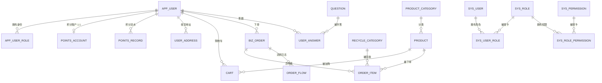
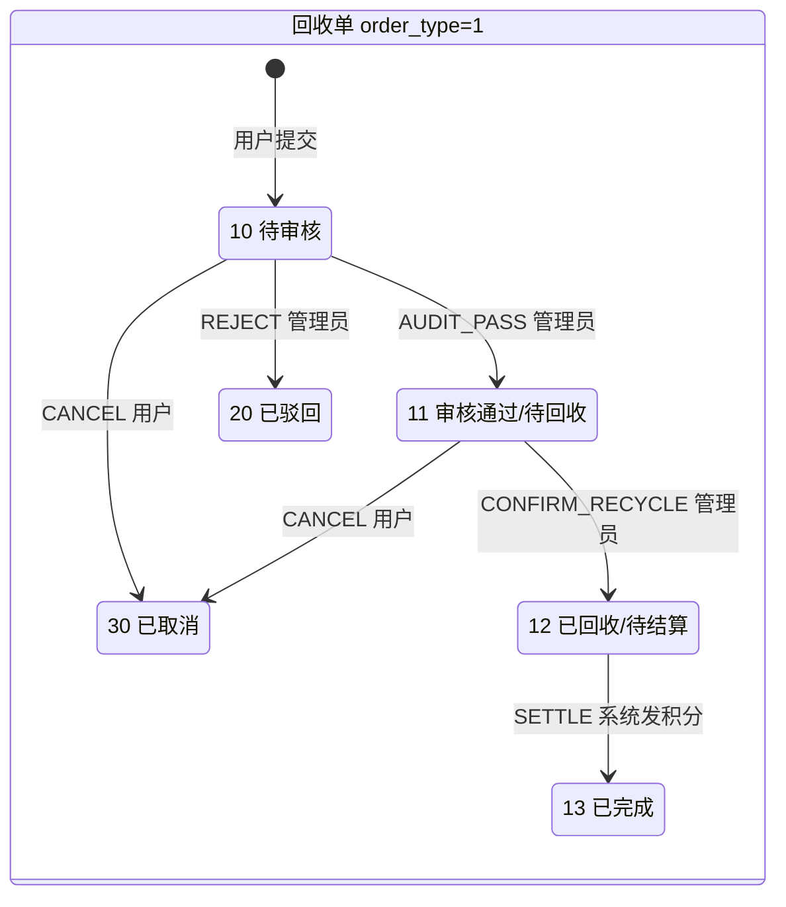
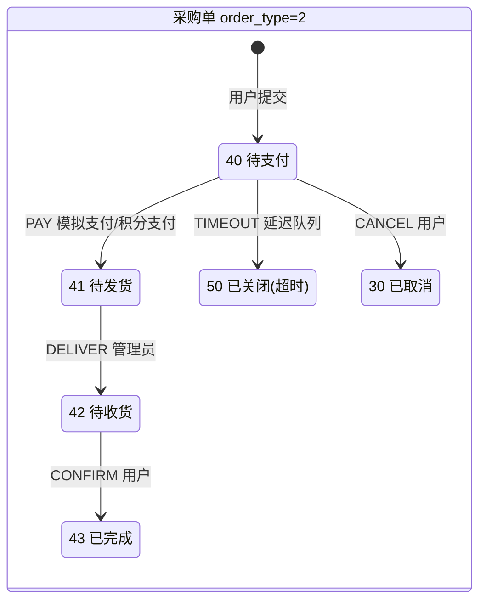

# 数据库设计说明

> 对应脚本：[`sql/V1__init_schema.sql`](../sql/V1__init_schema.sql)、[`sql/V2__init_data.sql`](../sql/V2__init_data.sql)
> 数据库：MySQL 8.0+ / InnoDB / utf8mb4_0900_ai_ci

---

## 1. 设计原则

| 原则 | 具体做法 | 反例（会被面试官追问的点） |
|---|---|---|
| 金额精确 | 金额、积分一律用 `INT` 存**分** / 整数积分 | 用 `FLOAT/DOUBLE` 存金额，累计后出现 0.01 误差 |
| 状态可读 | 状态用 `TINYINT` + Java 枚举，状态含义收敛在枚举里 | 业务代码里到处 `if (status == 3)` 魔法数字 |
| 删除可逆 | 统一 `deleted TINYINT` 逻辑删除，且与业务键组成联合唯一索引 | 只加 `deleted` 不加进唯一索引 → 删了 A 就再也建不了 A |
| 快照隔离 | 订单明细存商品**快照**（名称/规格/单价/积分/图片） | 明细只存 `product_id` → 商品改价后历史订单金额全变 |
| 幂等兜底 | 关键业务用**唯一索引**做最终防线，而非应用层 `if` 判断 | 并发下 `select` 再 `insert` 必然重复发放积分 |
| 无物理外键 | 表间关系由应用层与索引保证，不建 `FOREIGN KEY` | 建外键导致写放大、无法分库、DDL 变更困难 |
| 时间统一 | 统一 `DATETIME`，不用 `TIMESTAMP` | `TIMESTAMP` 有 2038 问题且随会话时区隐式转换 |

---

## 2. ER 关系总览



---

## 3. 表清单与职责

### 3.1 管理后台 RBAC（5 张）

| 表 | 职责 | 关键设计 |
|---|---|---|
| `sys_user` | 后台管理员 | 密码 BCrypt（不可逆、自带盐） |
| `sys_role` | 角色 | `role_code` 而非 id 做业务判断，避免硬编码数字 |
| `sys_permission` | 权限树 | `perm_type` 1目录/2菜单/3按钮，一张表承载三级 |
| `sys_user_role` | 用户↔角色 | 唯一键 `(user_id, role_id)` |
| `sys_role_permission` | 角色↔权限 | 唯一键 `(role_id, permission_id)` |

**为什么权限要三合一成一张表？** 目录、菜单、按钮在前端是同一棵树的三种节点类型，后端一次查询、一次建树即可下发，前端拿到树后：目录/菜单 → `addRoute` 动态注册路由，按钮 → 生成 `perm_code` 集合供 `v-permission` 指令判断。若拆成「菜单表 + 按钮表」，前端要合并两棵树，反而更复杂。

### 3.2 小程序用户（2 张）

| 表 | 职责 | 关键设计 |
|---|---|---|
| `app_user` | 小程序用户 | 唯一键 `(openid, deleted)` |
| `app_user_role` | 身份：回收方 / 采购方 | **关联表**，一个人可同时拥有两种身份 |

**为什么身份用关联表而不是 `app_user.role` 单字段？**
一个实验室账号完全可能既交废电池（回收方）又买新电池（采购方）。单字段会逼你在业务里做 `role = 3 表示两者都是` 这种丑陋妥协，且无法表达"该用户以哪种身份下的这一单"。关联表 + 下单时在订单上记录 `order_type`，语义清晰且可扩展。

### 3.3 商品与回收（3 张）

| 表 | 职责 | 关键设计 |
|---|---|---|
| `product_category` | 商品分类（两级树） | `parent_id = 0` 为根 |
| `product` | 商品 | `product_type` 区分采购品/兑换品/两者皆可 |
| `recycle_category` | 回收品类 | 独立成表，因为它是**「按单位给积分」**而非「按单价卖钱」 |

**为什么回收品类不合并进 `product`？**
二者计价模型根本不同：商品是「单价（分）× 数量 = 应付金额」，回收品类是「每单位积分 × 数量 = 应得积分」，且回收品类没有库存、没有 SKU 概念。硬合并会导致 `product` 表一半字段对回收品类永远为 NULL，是一种典型的"过度统一"。

### 3.4 交易（订单 3 张 + 购物车 + 地址）

| 表 | 职责 | 关键设计 |
|---|---|---|
| `biz_order` | 订单主表 | 回收单/采购单统一，`order_type` 区分 |
| `order_item` | 订单明细 | **存商品快照**，`item_type` 区分商品/回收品类 |
| `order_flow` | 流转日志 | 每次状态变更插一条，进度查询直接读它 |
| `cart` | 购物车 | 唯一键 `(user_id, product_id)` 兜住并发重复加购 |
| `user_address` | 收货地址 | `(user_id, is_default)` 快速取默认地址 |

**为什么表名是 `biz_order` 而不是 `order`？**
`ORDER` 是 MySQL 保留关键字（用于 `ORDER BY`）。用 `order` 作表名意味着**每一条 SQL 都必须写反引号**，而在 MyBatis 动态 SQL 里漏一个反引号就是运行时语法错误。这是纯粹的自我麻烦，加个前缀一劳永逸。

**为什么回收单和采购单共用一张主表？**
两者的生命周期高度同构：都是「提交 → 审核/支付 → 履约 → 确认 → 完成」，都需要地址、流转日志、进度查询、后台多条件检索。统一后：
- 后台"全部订单"检索、导出、看板统计只需写一套动态 SQL；
- `order_flow` 一套日志表覆盖两类业务；
- 差异部分（状态机）用**策略模式**按 `order_type` 分发，这是这个项目最好的设计亮点之一。

风险是字段有一定冗余（回收单不用 `pay_type`），但相比拆成两张表后所有查询、统计、日志都要写两遍，这个代价完全可以接受。

### 3.5 积分（2 张）

| 表 | 职责 | 关键设计 |
|---|---|---|
| `points_account` | 积分账户（余额） | 唯一键 `user_id`，`version` 乐观锁 |
| `points_record` | 积分流水 | 唯一键 `(user_id, biz_no, change_type)` 做幂等 |

### 3.6 问答（2 张）

| 表 | 职责 | 关键设计 |
|---|---|---|
| `question` | 题库 | `options` 用 `JSON` 存选项，题型可变 |
| `user_answer` | 答题记录 | 唯一键 `(user_id, question_id)` 防重复作答 |

### 3.7 日志（2 张）

| 表 | 职责 |
|---|---|
| `sys_operation_log` | 操作日志，由 `@Log` 注解 + AOP 异步落库 |
| `sys_login_log` | 登录日志 |

---

## 4. 三个必须讲清楚的设计细节

### 4.1 逻辑删除与唯一索引的冲突（高频踩坑点）

**问题**：`sys_user` 想给 `username` 加唯一索引，同时又要逻辑删除。如果只建 `UNIQUE(username)`：

```sql
-- 删除账号 zhangsan
UPDATE sys_user SET deleted = 1 WHERE username = 'zhangsan';
-- 之后想重新创建 zhangsan → 直接唯一键冲突，永久无法创建
INSERT INTO sys_user (username, ...) VALUES ('zhangsan', ...);  -- Duplicate entry!
```

**解法**：把 `deleted` 放进唯一索引，即 `UNIQUE KEY uk_username (username, deleted)`。

**残留局限（要主动说出来，别等面试官挑）**：`deleted` 只有 0/1，所以「同名账号最多只能被删除一次」。对本项目完全够用（管理员账号不会反复删建）。若业务真需要无限次删建，标准解法是把 `deleted` 改成 `BIGINT`，删除时写入当次时间戳或主键 id（`SET deleted = id`），使 `(username, deleted)` 组合永远唯一。

### 4.2 订单明细为什么必须存快照

```sql
-- ✗ 错误做法：只存 product_id，展示时 join product
SELECT oi.quantity, p.name, p.price FROM order_item oi JOIN product p ON oi.item_id = p.id;
```

商品明天从 1.20 元涨到 1.50 元，用户昨天那笔订单的金额就跟着变了——**历史订单不可篡改**是交易系统的底线。同理，商品下架（`status = 0`）或被删除后，join 会直接查不到商品，订单详情页变成空白。

所以 `order_item` 冗余 `item_name / item_spec / item_unit / item_cover / price / points` 六个快照字段。这是**有意的反范式**，用少量存储换取交易数据的不可变性。

### 4.3 订单状态机（本项目最值得讲的技术亮点）

回收单与采购单是两套状态机，各自独立，**用 `order_type` + 策略模式分发，非法流转直接拒绝**。





**状态码分配**（`SmallInt`，刻意分段以免两套状态机混淆）：

| 状态码 | 枚举名 | 回收单含义 | 采购单含义 |
|---|---|---|---|
| 10 | `PENDING_AUDIT` | 待审核 | — |
| 11 | `AUDIT_PASSED` | 审核通过/待回收 | — |
| 12 | `COLLECTED` | 已回收/待结算 | — |
| 13 | `COMPLETED` | 已完成 | — |
| 20 | `REJECTED` | 已驳回 | — |
| 30 | `CANCELLED` | 已取消 | 已取消 |
| 40 | `PENDING_PAY` | — | 待支付 |
| 41 | `PAID` | — | 待发货 |
| 42 | `DELIVERED` | — | 待收货 |
| 43 | `FINISHED` | — | 已完成 |
| 50 | `CLOSED` | — | 超时关闭 |

**积分兑换走哪条状态机？** 复用采购单（`order_type = 2`），只是 `pay_type = 1`（积分支付）。
因为积分在兑换时即时扣减，订单直接进入 `41 待发货`，跳过 `40 待支付`。后续发货、收货流程与采购单完全一致——这是统一订单表带来的直接收益。

---

## 5. 索引设计与验证

### 5.1 `biz_order` 的四个索引，每一个都有明确用途

| 索引 | 服务的查询 | 为什么不能省 |
|---|---|---|
| `idx_user_type_status_time (user_id, order_type, status, create_time)` | 小程序「我的订单」列表 | 必定带 `user_id`；`create_time` 放在最后让排序走索引，避免 `filesort` |
| `idx_type_status_time (order_type, status, create_time)` | 后台按类型+状态筛选 | 后台**不带** `user_id`，无法命中上一个索引的最左前缀 |
| `idx_status_time (status, create_time)` | 后台「全部订单按状态」 | 跨类型只看状态，前两个索引都命中不了 |
| `idx_create_time (create_time)` | 看板按时间范围聚合 | 纯时间范围查询无法命中任何以 `user_id`/`order_type`/`status` 打头的组合索引 |

> **面试会问**："加这么多索引不影响写入吗？"
> 答：会影响，`biz_order` 是写多读也多的表，每多一个二级索引，INSERT/UPDATE 都要多维护一棵 B+ 树。这四个索引的取舍依据是：**本项目订单表以「按用户查」「按状态查」「按时间统计」三类查询为主，且都出现在核心页面链路上**，索引带来的读性能收益远大于写代价。如果后续写入压力成为瓶颈，第一步应该砍掉 `idx_status_time`（它服务的"全部订单"页面可以强制要求先选类型），而不是无脑加索引。

### 5.2 索引验证方法（要能现场演示）

```sql
-- 1. 小程序"我的订单"：期望 type=ref, key=idx_user_type_status_time, Extra 无 Using filesort
EXPLAIN SELECT * FROM biz_order
WHERE user_id = 100 AND order_type = 2 AND status = 43 AND deleted = 0
ORDER BY create_time DESC LIMIT 10;

-- 2. 后台按状态分页：期望 key=idx_status_time
EXPLAIN SELECT * FROM biz_order
WHERE status = 40 AND deleted = 0
ORDER BY create_time DESC LIMIT 20;

-- 3. 看板时间范围聚合：期望 key=idx_create_time
EXPLAIN SELECT DATE(create_time) d, COUNT(*) FROM biz_order
WHERE create_time >= '2026-10-01' AND create_time < '2026-11-01' AND deleted = 0
GROUP BY d;

-- 4. 最左前缀反例：跳过后缀列，索引退化为只用到 user_id 一列
EXPLAIN SELECT * FROM biz_order WHERE status = 40 AND deleted = 0;  -- 用不上 idx_user_*
```

**要看懂的三列**：`type`（至少要 `ref`，出现 `ALL` 就是全表扫描）、`key`（实际命中的索引）、`Extra`（出现 `Using filesort` / `Using temporary` 就要警惕）。

### 5.3 幂等类索引（业务正确性依赖，不能删）

| 索引 | 防的是什么 |
|---|---|
| `points_record.uk_user_biz_type (user_id, biz_no, change_type)` | 同一笔业务重复发放/重复扣减积分 |
| `user_answer.uk_user_question (user_id, question_id)` | 重复提交答案、重复加积分 |
| `cart.uk_user_product (user_id, product_id)` | 并发重复加购产生两行 |
| `points_account.uk_user_id (user_id)` | 并发首次初始化账户产生两个账户 |
| `biz_order.uk_order_no (order_no)` | 订单号重复（理论上不会，但要有兜底） |

---

## 6. 积分的并发与幂等（核心难点）

### 6.1 三道防线

**第一道：唯一索引兜底（最终防线）**
`points_record` 的 `uk_user_biz_type`。并发下应用层的"先查再插"必然失效（两个线程都在对方提交前查到了"不存在"），唯一索引 + 捕获 `DuplicateKeyException` 才是可靠的。

**第二道：带条件的原子扣减（防超扣）**

```sql
-- 余额充足才扣，扣不动说明余额不足 → 靠 affectedRows 判断，无需先 SELECT
UPDATE points_account
SET balance = balance - #{points}, total_spend = total_spend + #{points}, version = version + 1
WHERE user_id = #{userId} AND balance >= #{points};

-- 库存同理，防超卖
UPDATE product
SET stock = stock - #{qty}, sold_count = sold_count + #{qty}
WHERE id = #{productId} AND stock >= #{qty};
```

这比"先 `SELECT balance` 再判断"强：后者两步之间存在竞态窗口，且多一次往返。

**第三道：事务保证账户与流水同生共死**

```java
@Transactional(rollbackFor = Exception.class)  // 必须显式指定 rollbackFor
public void changePoints(Long userId, int delta, ChangeType type, String bizNo) {
    // 1. 先插流水（唯一索引在这里拦截重复请求）
    pointsRecordMapper.insert(record);
    // 2. 再改余额（条件更新，扣不动就抛业务异常 → 整体回滚）
    int rows = pointsAccountMapper.deduct(userId, delta);
    if (rows == 0) {
        throw new BizException(ErrorCode.POINTS_NOT_ENOUGH);
    }
}
```

### 6.2 `@Transactional` 的四个失效场景（面试必问，必须能答）

| 场景 | 为什么会失效 | 正确写法 |
|---|---|---|
| 同类内部方法自调用 | 走的是 `this` 引用，绕过了代理对象 | 注入自身 / 拆到另一个 Bean / 用 `AopContext.currentProxy()` |
| 方法不是 `public` | Spring AOP 默认只代理 public 方法 | 改成 public |
| 异常被自己 catch 吞掉 | 代理收不到异常，不会回滚 | 捕获后重新抛出，或手动 `TransactionAspectSupport.currentTransactionStatus().setRollbackOnly()` |
| 抛的是受检异常 | 默认只对 `RuntimeException`/`Error` 回滚 | `@Transactional(rollbackFor = Exception.class)` |

### 6.3 对账思路（这是加分项）

`points_record.balance_after` 记录了每笔变动后的余额快照，可以写一个定时任务校验：

```sql
-- 找出「流水最后一条的 balance_after」与「账户当前 balance」不一致的用户
SELECT r.user_id, r.balance_after AS record_balance, a.balance AS account_balance
FROM (SELECT user_id, balance_after,
             ROW_NUMBER() OVER (PARTITION BY user_id ORDER BY id DESC) rn
      FROM points_record) r
JOIN points_account a ON a.user_id = r.user_id
WHERE r.rn = 1 AND r.balance_after <> a.balance;
```

**能主动说出"我做了对账校验"的候选人，在这个层级的项目里是极少数。**

---

## 7. 命名与字段规范

| 类别 | 规范 | 示例 |
|---|---|---|
| 表名 | 小写下划线，业务表可加模块前缀避开保留字 | `biz_order`、`sys_user`、`app_user` |
| 主键 | 一律 `id` | `id BIGINT AUTO_INCREMENT` |
| 外键列 | `<被引用表单数>_id` | `user_id`、`product_id`、`order_id` |
| 布尔语义 | `is_xxx` / `has_xxx`，`TINYINT` 且注释写清 0/1 含义 | `is_default 0否 1是` |
| 时间 | `xxx_time` 用 `DATETIME` | `pay_time`、`finish_time` |
| 枚举 | `TINYINT`/`SMALLINT`，注释列出全部取值 | `status TINYINT COMMENT '0禁用 1启用'` |
| 每张表必备 | `create_time`、`update_time` | 业务表额外加 `deleted` |

---

## 8. 后续可扩展方向（现在不做，但要知道怎么加）

| 扩展点 | 做法 |
|---|---|
| 数据字典表 | 加 `sys_dict_type` / `sys_dict_data`，后台所有枚举下拉改为配置驱动 |
| 分库分表 | 订单表按 `user_id` 取模分表，主键改雪花 ID（业务层不感知） |
| 读写分离 | `biz_order`、`points_record` 走从库；用 `@DS` 注解或 ShardingSphere |
| 回收地址池 | 新增 `recycle_station` 表，回收单可指定投递站点而非上门 |
| 积分过期 | `points_account` 加 `expire_at`，`points_record` 加批次维度，配合定时任务扣减 |
